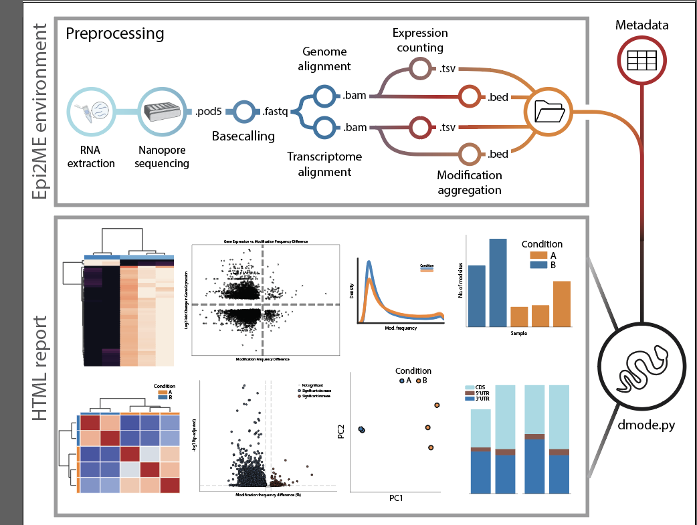

# DModE-preprocessing

A [Nextflow](https://www.nextflow.io/) pipeline for preprocessing Oxford Nanopore direct RNA sequencing data as part of the **DModE** (Differential Modification and Expression) framework. Starting from raw POD5 files (or basecalled BAMs), it produces aligned BAMs, gene/transcript expression quantifications, and per-site RNA modification pileups.

> **Direct RNA only.** Alignment (`-uf`), strand-specific gene counting (`-s 1`), oarfish (`ont-drna`) and RNA modification calling all assume nanopore direct RNA reads. cDNA or DNA data is not supported.

---

## Pipeline overview



| Step | Tool | Purpose |
|------|------|---------|
| Basecalling | [Dorado](https://github.com/nanoporetech/dorado) | Convert POD5 signals to reads; optionally call RNA modifications (skipped for BAM input) |
| Genome alignment | Minimap2 (`splice -uf -k14`) | Splice-aware alignment|
| Transcriptome alignment | Minimap2 (`map-ont`) | transcriptome alignment |
| Gene expression | featureCounts (`-L` long-read mode, `-s 1` stranded) | Gene-level read counts from genome-aligned BAM |
| Transcript expression | [oarfish](https://github.com/COMBINE-lab/oarfish) | Long-read transcript quantification (read mode with a shared index; `--seq-tech ont-drna`, forward strand only, truncation model) |
| QC | NanoComp | Alignment statistics comparing genome vs. transcriptome BAMs |
| Modification pileup | [Modkit](https://github.com/nanoporetech/modkit) | Per-site modification frequency on genome and transcriptome |
| Differential analysis | [DModE](https://github.com/stegiopast/dmode) | Differential expression and modification between conditions (samplesheet input) |

---

## Tool versions

| Step | Version | Container |
|------|---------|-----------|
| Basecalling | Dorado 2.1.1 | `ontresearch/dorado:sha9809639e07a927bcc0f584dadd5e59674cf59f3f` |
| Alignment, BAM handling | minimap2 2.31, samtools 1.24 | `nanozoo/minimap2:2.31--c2b4c91` |
| Gene counts | featureCounts (subread) 2.1.1 | `quay.io/biocontainers/subread:2.1.1--h577a1d6_0` |
| Transcript quantification | oarfish 0.13.0 | `quay.io/biocontainers/oarfish:0.13.0--hd727d2a_0` |
| Modification pileup | modkit 0.6.4 | `quay.io/biocontainers/ont-modkit:0.6.4--h7f49ad2_0` |
| QC | NanoComp 1.25.6 | `quay.io/biocontainers/nanocomp:1.25.6--pyhdfd78af_0` |
| Differential analysis | DModE | `jmiedema/dmode:0.3` (Docker Hub, see below) |

Alignment settings:

- Genome: `minimap2 -y --MD -ax splice -uf -k14` (forward strand only and k-mer 14, as recommended by minimap2 for nanopore direct RNA), keeping primary and supplementary alignments (`samtools view -F 260`).
- Transcriptome: `minimap2 -y --MD -ax map-ont`, keeping all records (unmapped, secondary, supplementary). Modkit pileup only uses primary alignments.
- `-y` carries the `MM`/`ML` modification tags from the basecalled reads into the alignments.

Transcript quantification: oarfish maps the basecalled reads itself (read mode) against an index built once from `--ref_transcriptome`, with `--filter-group no-filters -d fw --model-truncation --write-assignment-probs=compressed` (forward-strand alignments only, as direct RNA reads are sense strand; truncation model for 3'/5'-truncated reads; per-read assignment probabilities in `<sample>.prob.lz4`, about 14 MB per 100k reads). DModE reads oarfish's own `<sample>.quant` (`num_reads` per transcript) directly.

---

## Requirements

- **Nextflow** ≥ 22.10.0
- **Docker**
- **NVIDIA GPU** with CUDA (required for Dorado basecalling; not needed when starting from basecalled BAMs)
- **NVIDIA Container Toolkit** — allows Docker containers to access the GPU ([installation guide](https://docs.nvidia.com/datacenter/cloud-native/container-toolkit/latest/install-guide.html))

All tools run inside Docker containers — no manual software installation needed beyond Nextflow and the NVIDIA Container Toolkit. The CUDA toolkit does not need to be installed on the host; the Dorado container bundles everything it needs.

The DModE step uses the image set by `--dmode_container` (default `jmiedema/dmode:0.3`, pulled from Docker Hub automatically). It is built from a [dmode](https://github.com/johannesmiedema/dmode) checkout with `containers/dmode.Dockerfile`. To build your own version:

```bash
git clone https://github.com/johannesmiedema/dmode.git
docker build -f containers/dmode.Dockerfile -t <your-name>/dmode:<tag> ./dmode
# then run the pipeline with --dmode_container <your-name>/dmode:<tag>
```

---

## Input

Provide **exactly one** of:

| Parameter | Use case |
|-----------|----------|
| `--samplesheet` | Several samples, with conditions. Required for the DModE step. |
| `--pod5_dir` | One POD5 directory (or a quoted glob of directories). The directory name is the sample ID; for MinKNOW output (`<sample>/<YYYYMMDD_HHMM_…run folder>/pod5`) the sample folder name is used. IDs must be unique. |
| `--ubam` | One basecalled, unaligned BAM (or a quoted glob). The file name without `.bam` is the sample ID; IDs must be unique. |

### Samplesheet

Tab-separated, with a header:

```tsv
sample	condition	input
UHRR_1	UHRR	/data/UHRR_1/pod5
UHRR_2	UHRR	/data/UHRR_2/pod5
HEK_1	HEK293	/data/basecalled/HEK_1.bam
HEK_2	HEK293	/data/basecalled/HEK_2.bam
```

- `input` is either a **POD5 directory / `.pod5` file** (basecalled with Dorado) or an **unaligned `.bam`** (basecalling is skipped). Both kinds can be mixed in one sheet.
- `sample` may contain letters, digits, `.`, `_` and `-`, and must be unique.
- `condition` may contain letters, digits, `.`, `_` and `-`. It is required when DModE runs (`--run_dmode true`, the default); at least two conditions are needed and `--reference_levels` must name the control(s).

### Starting from basecalled BAMs

If you basecall yourself (e.g. with a Dorado version or model not bundled here), pass the **unaligned** Dorado BAM. Keep the `MM`/`ML` tags: if you basecalled with modification models, set `--mods` to the same models (e.g. `--mods m6A_DRACH`), so modkit pileup runs and uses the right per-modification thresholds. Each BAM is checked at the start:

- `--mods` set, but no `MM`/`ML` tags in the first 1000 reads → the run stops with an error.
- Modification tags present, but `--mods` not set → warning; modkit pileup is skipped.
- Reads already aligned → warning; reads are converted back to FASTQ and re-aligned.

---

## Quick start

Full run: basecalling, preprocessing and DModE:

```bash
nextflow run main.nf \
  --samplesheet samples.tsv \
  --reference_levels UHRR \
  --model sup \
  --mods "m5C_2OmeC,inosine_m6A_2OmeA,pseU_2OmeU,2OmeG" \
  --ref_genome ./refs/genome.fa \
  --ref_transcriptome ./refs/transcripts.fa \
  --genome_gtf ./refs/annotation.gtf
```

From already basecalled BAMs, preprocessing only:

```bash
nextflow run main.nf \
  --ubam "./basecalled/*.bam" \
  --mods m6A_DRACH \
  --ref_genome ./refs/genome.fa \
  --ref_transcriptome ./refs/transcripts.fa \
  --genome_gtf ./refs/annotation.gtf
```

To run without modification calling (expression only), leave out `--mods`.

---

## Parameters

### Required

| Parameter | Description |
|-----------|-------------|
| `--samplesheet` / `--pod5_dir` / `--ubam` | Input, see [Input](#input) |
| `--ref_genome` | Reference genome FASTA |
| `--ref_transcriptome` | Reference transcriptome FASTA |
| `--genome_gtf` | Genome annotation GTF |

### Optional

| Parameter | Default | Description |
|-----------|---------|-------------|
| `--outdir` | `./results` | Base output directory |
| `--model` | `sup` | Dorado basecalling model: `sup` (super accuracy), `hac`, or `fast` (POD5 input only) |
| `--max_reads` | `0` | Basecall only the first N reads per sample (Dorado `--max-reads`), e.g. for test runs. `0` = all reads. POD5 input only |
| `--use_gpu` | `cuda:all` | GPU selection for Dorado. Use `cuda:0`, `cuda:0,1`, etc. to restrict to specific GPUs |
| `--cpus` | `0` (automatic) | Threads per job. Automatic: alignment, modkit and oarfish get half of `--max_cpus`, Dorado 12, all other steps 4. A value > 0 gives every job exactly that many |
| `--max_basecalling` | `1` | Dorado basecalling jobs running at the same time (one GPU: keep 1) |
| `--max_cpus` | `0` (all cores) | Maximum CPUs used by all running jobs together; jobs wait until enough CPUs are free |
| `--max_alignments` | `1` | minimap2 jobs running at the same time, each for genome and transcriptome (genome alignment needs ~19 GB RAM) |
| `--publish_mode` | `copy` | Output file mode: `copy` (persistent) or `symlink` (space-saving, work dir must be preserved) |
| `--mods` | `false` | Comma-separated modification models. POD5 input: called by Dorado. BAM input: the models the BAM was basecalled with. Modkit pileup only runs when set |
| `--modkit_filter_threshold` | `0.8` | Modkit read-level filter threshold |
| `--modkit_mod_threshold` | `0.98` | Modkit per-modification probability threshold |

### DModE (samplesheet input only)

| Parameter | Default | Description |
|-----------|---------|-------------|
| `--run_dmode` | `true` | Run DModE after preprocessing. Set `false` to only preprocess |
| `--reference_levels` | – | Comma-separated control condition(s) |
| `--dmode_level` | `gene,transcript` | `gene` (featureCounts + genome modkit), `transcript` (oarfish + transcriptome modkit), or both |
| `--dmode_coverage` | `20` | Minimum site coverage |
| `--dmode_frequency` | `10` | Minimum modification frequency (%) |
| `--dmode_correction` | `SLIM` | `SLIM` or `BH` |
| `--dmode_alpha_mod` | `0.01` | Alpha for differential modification |
| `--dmode_alpha_exp` | `0.01` | Alpha for differential expression |
| `--dmode_modifications` | all | Restrict to types, e.g. `m6A,pseU` |
| `--dmode_basic_statistics` | `true` | Also run DModE basic statistics per level (PCA, UMAP, site counts, distributions, sample correlation). Needs `--mods` |
| `--dmode_container` | `jmiedema/dmode:0.3` | DModE container image |

With `--mods`, DModE runs per level the combined `diff_<level>_expression_and_modification` plus `diff_<level>_expression` and `diff_<level>_modification` on their own (and `<level>_basic_statistics`, see `--dmode_basic_statistics`); without `--mods`, only `diff_<level>_expression`. Results go to `<outdir>/dmode/<level>/`: the generated DModE metadata sheets (`counts_metadata.tsv`, `mods_metadata.tsv`) and `analysis/` with all tables and plots (with `--mods` also `<level>_basic_statistics/`). All levels are combined into one self-contained HTML report, `<outdir>/dmode/dmode_report.html`, with a page per analysis.

### Supported modifications (`--mods`)

Pass modification names as a comma-separated string. Compound names combine multiple callers (e.g., `m5C_2OmeC` calls both m5C and 2′-O-methylcytosine simultaneously).

| Name | Description |
|------|-------------|
| `m6A_DRACH` | N6-methyladenosine (DRACH-motif restricted) |
| `inosine_m6A_2OmeA` | Inosine / N6-methyladenosine / 2′-OMe-A |
| `m5C_2OmeC` | 5-methylcytosine / 2′-OMe-C |
| `pseU_2OmeU` | Pseudouridine / 2′-OMe-U |
| `2OmeG` | 2′-O-methylguanosine |

Each name is split at `_` and every part is looked up in `mod_map.tsv` to set the per-modification `--modkit_mod_threshold` (e.g. `inosine_m6A_2OmeA` → codes `17596`, `a`, `69426`).

---

## Tutorial: running with test data

A small test POD5 file (`testdata/1k_test_set.pod5`, ~1 k reads) is included in the repository so you can verify the pipeline works before committing to a full run.

You still need to supply your own reference files. For human data, the recommended sources are:

| File | Source |
|------|--------|
| Reference genome (FASTA) | [GENCODE GRCh38 genome](https://www.gencodegenes.org/human/) — *Genome sequence (GRCh38.p14)* |
| Reference transcriptome (FASTA) | [GENCODE GRCh38 transcriptome](https://www.gencodegenes.org/human/) — *Transcript sequences* |
| Genome annotation (GTF) | [GENCODE GRCh38 annotation](https://www.gencodegenes.org/human/) — *Comprehensive gene annotation* |

Once you have the reference files, run the pipeline on the test data without modification calling:

```bash
nextflow run main.nf \
  --pod5_dir ./testdata \
  --model fast \
  --ref_genome ./refs/genome.fa \
  --ref_transcriptome ./refs/transcripts.fa \
  --genome_gtf ./refs/annotation.gtf \
  --outdir ./test_results
```

`--model fast` is recommended here to reduce runtime. Note that modification calling requires `hac` or `sup` — `fast` does not support it. To also test modification calling, add `--mods`:

```bash
nextflow run main.nf \
  --pod5_dir ./testdata \
  --model hac \
  --mods "m6A_DRACH" \
  --ref_genome ./refs/genome.fa \
  --ref_transcriptome ./refs/transcripts.fa \
  --genome_gtf ./refs/annotation.gtf \
  --outdir ./test_results
```

Results will appear under `./test_results/` with the same folder structure described in [Outputs](#outputs).

---

## Running in Epi2ME Labs

This pipeline is compatible with the [Epi2ME Labs](https://labs.epi2me.io/) desktop application, which provides a GUI for running Nextflow workflows without the command line.

1. Open the Epi2ME Labs desktop app and go to **Workflows**.
2. Click **Add workflow** and paste the GitHub URL: `https://github.com/johannesmiedema/DModE-preprocessing`.
3. Once imported, select the workflow and click **Run**.
4. Fill in the parameters form — choose one input (samplesheet, POD5 folder or unaligned BAM) and the reference genome, reference transcriptome and GTF annotation. Set `--mods` if you want modification calling, and `reference_levels` for the DModE step.
5. Click **Launch**. Epi2ME manages Docker and Nextflow automatically; progress and logs are shown in the app.

Output files appear in the directory you configured for results, with the same folder structure described in the [Outputs](#outputs) section above.

---

## GPU & performance tips

- **`--model sup`** (default) gives highest accuracy but requires the most GPU memory. Switch to `hac` to reduce memory usage while retaining modification calling support. `fast` is the lightest option but **does not support modification calling** — do not combine `--model fast` with `--mods`.
- **`--mods`** requires `sup` or `hac`. It increases GPU memory and compute time proportionally to the number of modification types called. Start with a single modification if testing.
- **`--publish_mode symlink`** avoids copying large BAM files to the output directory. Only use this if you will not clean the Nextflow work directory.
- Use `--use_gpu cuda:0` to restrict Dorado to a specific GPU on a multi-GPU machine.

---

## Help

```bash
nextflow run main.nf --help
```
